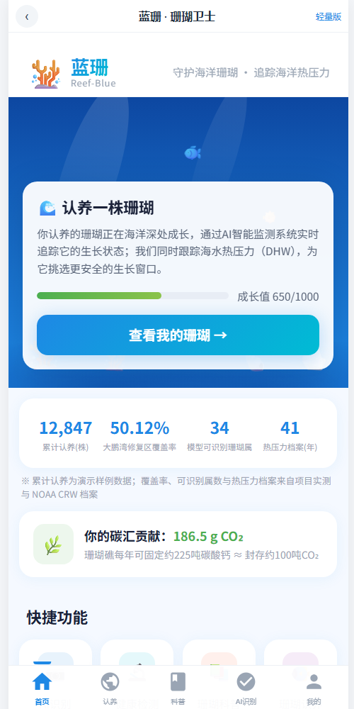
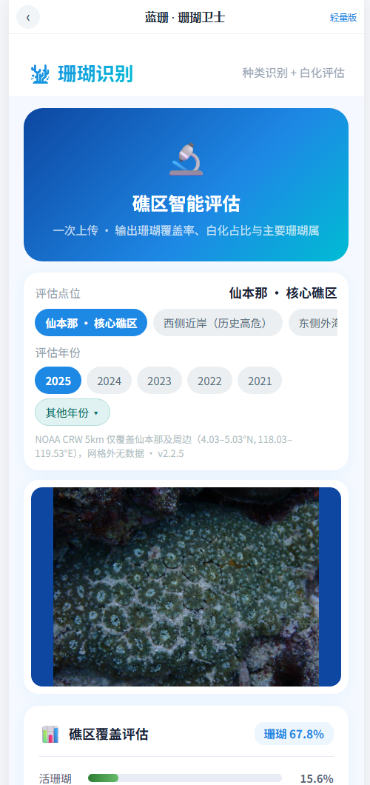
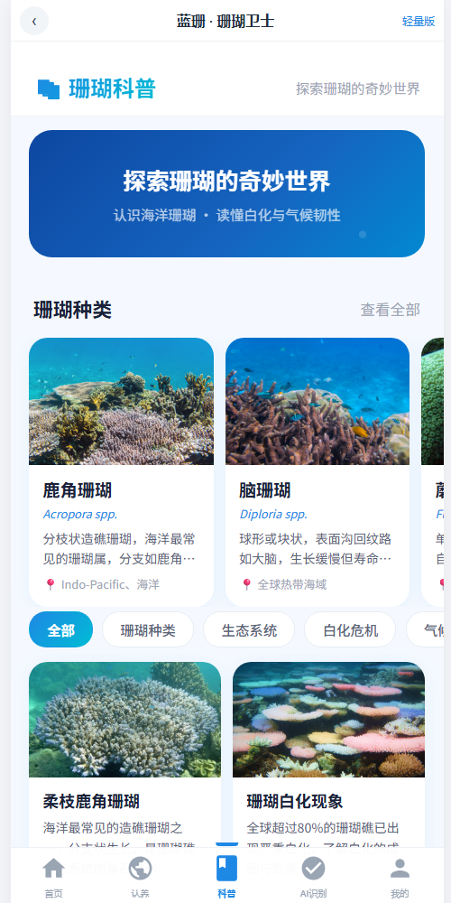
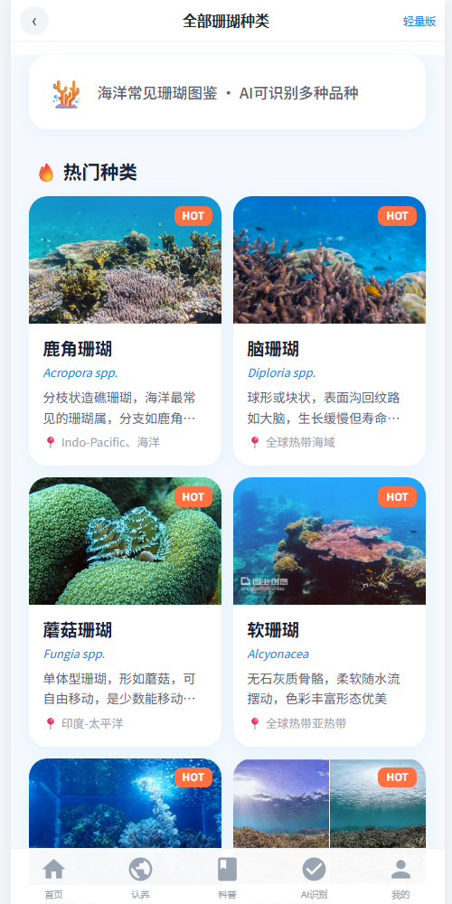
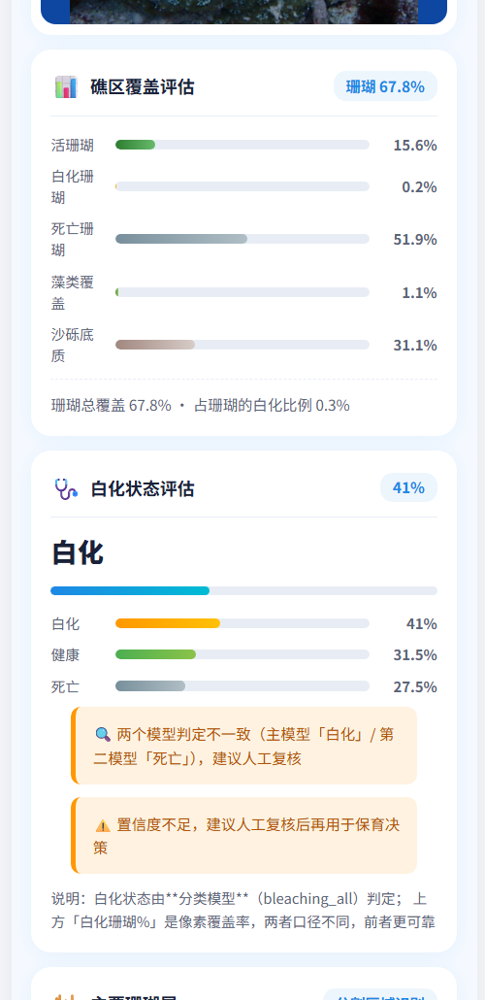

# 蓝珊 · 珊瑚卫士（Blue Coral Guardian）

> **一套能落地的珊瑚礁白化监测与保育决策系统**：拍照 → AI 识别（覆盖率 / 白化 / 珊瑚属 / 个体计数）
> → 叠加 41 年海洋热压力 → 输出修复优先级与中英文保育报告。
> **微信小程序 + 网页版 + 算法服务，一个仓库跑通。**

<p align="center">
  
  
  
  
</p>
<p align="center"><sub>首页 · AI 识别（上传与点位/年份）· 科普 · 全部珊瑚种类（网页版真实运行截图；小程序是同一套页面代码，共 23 页）</sub></p>

<p align="center">
  
</p>
<p align="center"><sub>
<b>AI 识别真实结果</b>：礁区覆盖 <b>67.8%</b>（活珊瑚 15.6% / 死亡 51.9% / 沙砾 31.1%）、整图白化 <b>41%</b>，<br>
两个白化模型判定不一致时自动提示「<b>建议人工复核</b>」（共识弃权机制）
</sub></p>

---

## 一、它能做什么（对应竞赛三条要求）

| 要求 | 完成情况 | 关键指标 |
|---|---|---|
| **① 影像识别** | **9 / 9 交付** | 覆盖率分割 mIoU **0.548**（星地对比 39.71% vs 39.56%）；34 属 Top-1 **86.1%**；白化三分类域内 **98.2%**；个体计数 mAP@0.5 **0.4217**（偏差 +2.3%）；拍摄质量闸门 5/5；水下预处理（降噪/光照/去蓝绿偏色）已实现并**量化了适用边界** |
| **② 长时序热压力** | **5 / 5 完成** | **1985–2025 共 41 年逐日** DHW / HotSpot / 官方 BAA 预警等级，544 个 5km 格点；异常时段（5–8 月）；历史白化事件分布（报告年表 + GCBD 34,846 条记录）|
| **③ 综合研判** | **5 / 6 完成** | 气候韧性规则评分 + 修复优先级 + 投放时间窗（35 格点不建议投放 / 88 格点从未警报 / 421 格点需避开风险月）+ **中英文评估报告自动生成**（一次返回、数值完全一致）|
| **合计** | **19 / 20 项**（1 项受数据限制：气候韧性缺乏投放后存活率数据） | 端到端回归 **25/25**、全项目体检 **26/26** |

**额外交付**：跨域白化（太平洋岛屿 bleached F1 **0.838**）、**双模型共识弃权**（一致才直判，分歧提示人工复核）、
网页版（**23 页全部可在浏览器使用**，无需微信开发者工具）。

---

## 二、系统架构

```
┌─────────────────┐   ┌──────────────────┐
│ 微信小程序       │   │ 网页版（H5）      │   ← 两套前端，同一个后端
│ miniprogram/    │   │ ai-service/web/  │
└────────┬────────┘   └────────┬─────────┘
         │   HTTP/JSON（同一套接口）  │
         └────────────┬────────────┘
                      ▼
        ┌──────────────────────────────────┐
        │ 推理服务 ai-service/scripts/      │
        │        serve_fusion.py           │
        │                                  │
        │ ① 影像：SegFormer 覆盖率          │
        │        ConvNeXt 属 / 白化(双模型)  │
        │        YOLOv9 个体计数            │
        │ ② 环境：NOAA CRW 41 年热压力      │
        │ ③ 研判：修复优先级 + 中英报告      │
        └──────────────────────────────────┘
```

---

## 三、快速开始（3 步，约 10 分钟）

> 需要 Python 3.10+（本项目在 3.12 上开发）；有 NVIDIA 显卡更快，**纯 CPU 也能跑**（约 5–10 秒/张）。

```bash
git clone https://github.com/starhaohanwuyin/blue-coral-guardian.git
cd blue-coral-guardian/ai-service

# ① 安装依赖
pip install -r requirements.txt

# ② 准备模型权重（约 470 MB）——二选一：
#    a) 从本仓库 Release 下载（推荐，需联网）
python tools/download_weights.py
#    b) 离线：从交付包/已有的 weights 目录拷贝
# python tools/download_weights.py --from-dir D:\path\to\delivery\weights

# ③ 启动服务（首次加载 4 个模型，等 40–90 秒）
cd scripts
python serve_fusion.py --host 0.0.0.0 --port 8000
```

然后浏览器打开 **http://127.0.0.1:8000/** —— 完整的 23 页小程序界面；
只想用识别功能可开 **http://127.0.0.1:8000/lite.html**。
手机（同一 Wi-Fi）访问 `http://<电脑局域网IP>:8000/`。

**Windows 一键版**：双击根目录的 `启动演示.bat`（自动检查权重 → 启动服务 → 打开浏览器）。

**演示前自检**：`python ai-service/tools/selfcheck.py`（24 项：环境/权重/数据/网页资源/服务状态）

> ✅ **已做过开箱验证**：全新克隆 → `download_weights.py` **2 分钟**取回 470 MB → 自检 **24/24** →
> 仓库自带 e2e 回归 **24/24** → 网页版 23 页渲染无错误。全过程与证据见 [`开箱验证记录.md`](开箱验证记录.md)。

---

## 四、目录结构

```
blue-coral-guardian/            ← 克隆下来的目录名
├── README.md                     ← 本文件
├── 演示指南.md                    ← 3 分钟演示脚本 + 答辩问答准备
├── 启动演示.bat                   ← Windows 一键启动（检查权重 → 起服务 → 开浏览器）
├── miniprogram/                  ← 微信小程序（23 页，可直接用微信开发者工具打开）
└── ai-service/                   ← 算法与推理服务
    ├── scripts/                  ← serve_fusion.py（推理服务）、训练/评测脚本
    ├── web/                      ← 网页版（23 页运行时 + 轻量识别页 + 本地图片）
    ├── tools/                    ← download_weights.py、selfcheck.py、网页版构建器
    ├── docs/                     ← 网页版部署指南、项目交接与续接指引（含全部踩坑记录）
    ├── reports/                  ← 全部结果 JSON/MD、最终结果汇总、截图
    └── data/noaa/                ← 演示所需气候数据（climate_index + site_profiles）
```

---

## 五、主要成果（可直接引用）

| 项目 | 结果 | 证据文件 |
|---|---|---|
| 礁区覆盖分割 | mIoU **0.5484**；星地对比 **39.71% vs 39.56%** | `reports/segmentation_miou_1024.json` |
| 珊瑚属识别 | Top-1 **86.12%**（34 属，剔泄漏）| `reports/protocol_species_ip_test_clean.json` |
| 白化状态 | 域内 **98.21%**；线上模型白化召回 **99.26%** | `reports/new_bleaching_bleaching_all_test_clean168.json` |
| 跨域白化 | 太平洋岛屿 bleached **F1 0.838**；Koh Tao 湿季宏 F1 0.555；Arafura 0.398 | `reports/matrix_pacific_multidomain4.json`、`matrix_winter_multidomain4.json`、`matrix_external_multidomain4.json` |
| 个体计数 | mAP@0.5 **0.4217**；总量偏差 **+2.3%** | `reports/yolo_coral_metrics.json` |
| 41 年热压力 | 1985–2025 逐日 DHW/BAA；544 格点 | `data/noaa/climate_index.json` |
| 投放时间窗 | 35 格点不建议投放 / 88 格点从未警报 / 421 需避开风险月 | `reports/deployment_windows.json` |
| 中英文报告 | 逐节对齐、数值完全一致 | `/analyze` → `restoration.report` / `reportEn` |

**口径提示（引用时请带上）**：覆盖率仅**区域尺度**（5km 格点 ≠ 礁点）；白化是**整图级**结论；
环境数据是**历史值不是实时预警**；只覆盖仙本那及周边网格；**不做投放效果评估**（无存活率数据）。

---

## 六、已知局限（如实说明）

| 局限 | 原因 |
|---|---|
| 气候韧性只有规则评分，没有标定指标 | 缺少投放后存活率的多年跟踪数据 |
| Arafura / Koh Tao 跨域白化仍偏弱（0.28–0.29）| 这两个海域标注样本少 |
| 站点级排序不成立 | 实地样点仅 3–4 个（偏差 +11.7pt、r = −0.56）|
| 拍摄质量闸门阈值来自合成降质集 | 真实劣化照片（15m 浑浊）未验证 |
| 物种级识别缺失 | 只有 34 属；水下照片人眼也难分种 |
| 环境数据仅覆盖仙本那网格 | 网格外直接返回无数据，不给"最近格点" |

---

## 七、技术栈

**算法**：PyTorch · HuggingFace Transformers（SegFormer-B2）· torchvision（ConvNeXt-Tiny）· YOLOv9
**服务**：FastAPI · Uvicorn（CORS 已开，支持前后端分离部署）
**前端**：微信小程序原生（WXML/WXSS）+ 自研浏览器端小程序运行时（`web/mp.js`，让同一套页面代码跑在 H5）
**环境数据**：NOAA Coral Reef Watch v3.1（5km，DHW / HotSpot / BAA / SSTA / SST）

---

## 八、许可证与致谢

- 数据来源：NOAA CRW（公开产品）、Kaggle 珊瑚白化数据集、CoralScapes 分割数据集、GCBD 全球白化数据库
- 本项目为**学科竞赛作品**，模型与数据仅用于研究与教学演示
