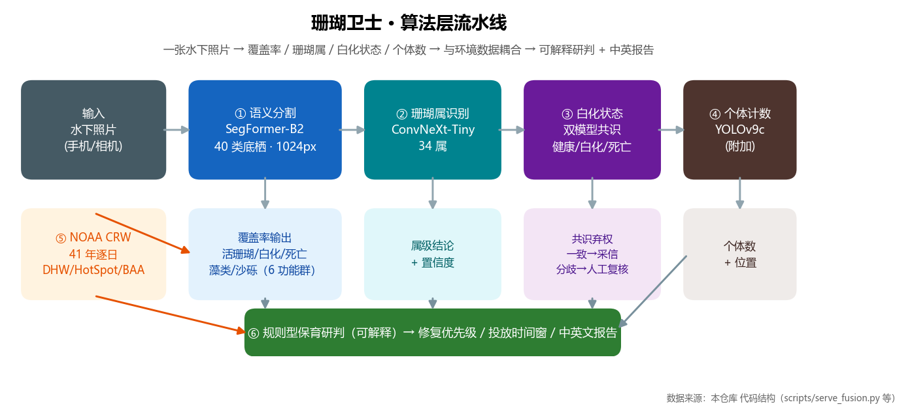
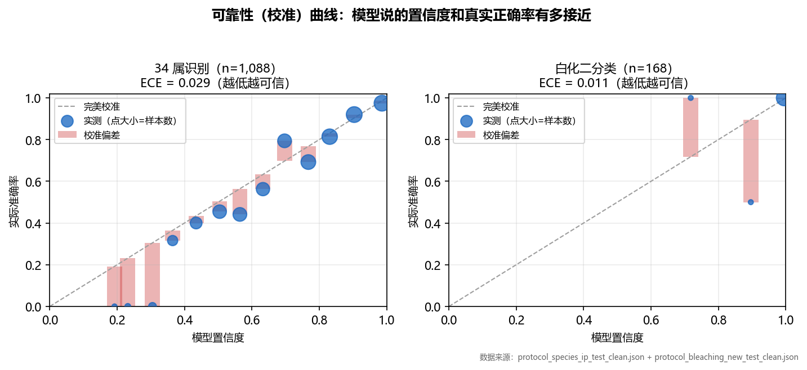
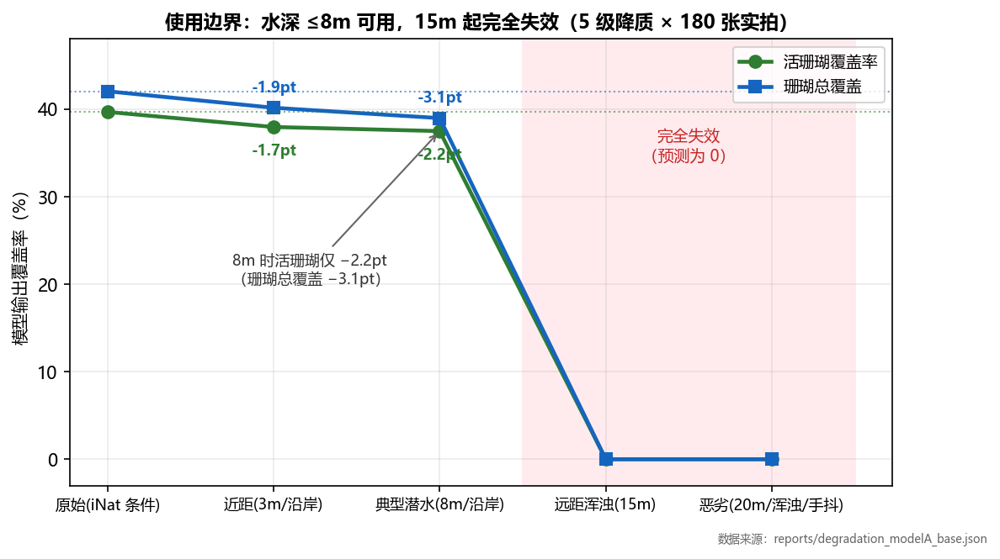
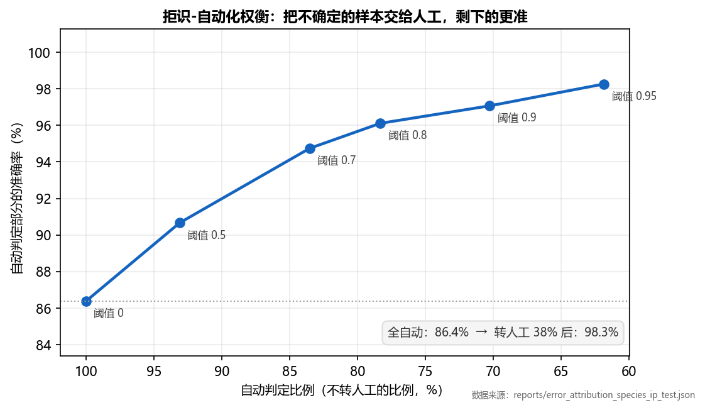
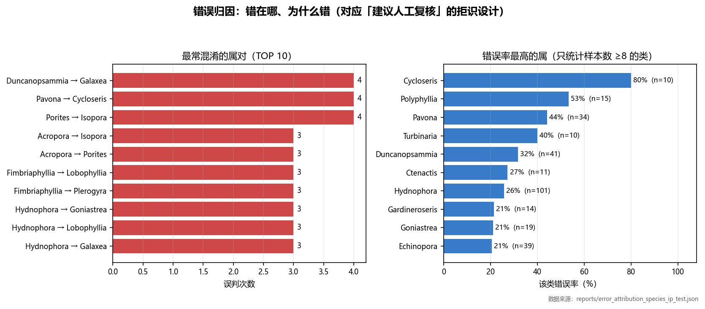
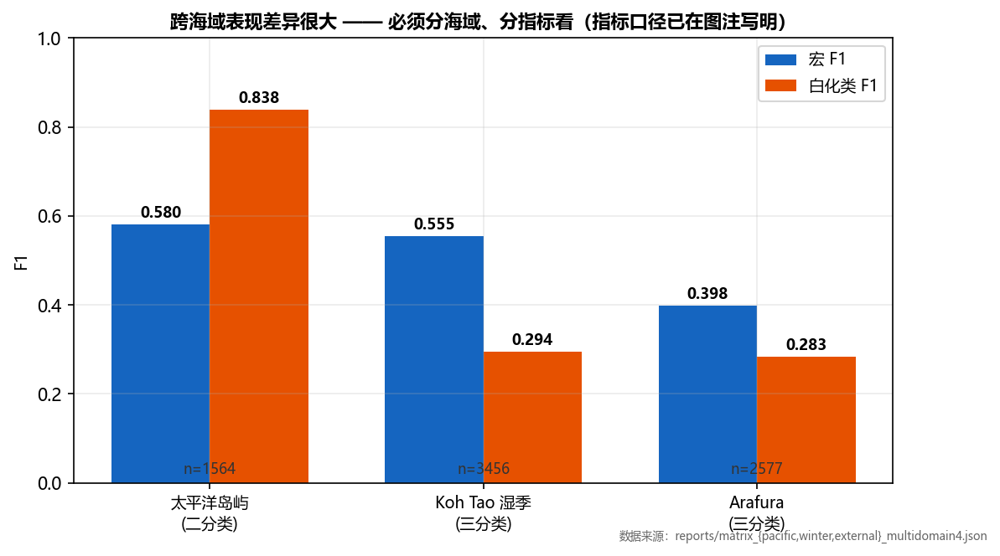

# 珊瑚卫士 · 多模型融合的水下珊瑚智能识别与监测系统

> 本文件为**对外统一口径**：所有数字均可按文末「评测文件索引」逐一复核。
> 配图：6 张算法层图表（`images/algo/`，由 `ai-service/tools/make_algo_figures.py` 从 `reports/` 既有结果生成，可复现）。
> 最后核对日期：2026-10-15（模型规格经权重配置与模型 ID 双重确认；
> 本文件 **32 项数字已用脚本与 `reports/` 原始报告自动比对，全部一致**）。

---

## 【技术架构】

**· 算法层**

| 模块 | 模型 / 方法 | 说明 |
|---|---|---|
| 礁区覆盖率 | **SegFormer-B2** 语义分割（Coralscapes 数据集，40 类底栖，1024px）| 输出 6 大功能群覆盖比例 |
| 珊瑚属识别 | **ConvNeXt-Tiny**（34 属）| 仙本那地理隔离留出集验证 |
| 白化状态 | **ConvNeXt-Tiny** 三分类（健康 / 白化 / 死亡）| **双模型共识弃权** |
| 个体计数 | **YOLOv9c** 目标检测（附加能力）| 输出个体数量与位置 |
| 环境耦合 | NOAA CRW v3.1 5km 卫星产品 | **1985–2025 共 41 年逐日** DHW / HotSpot / 官方 BAA 预警等级 |
| 保育研判 | 可解释的规则型决策支持 | 修复优先级 + 投放时间窗 + 中英文报告 |

**共识弃权机制（三档）**：两个白化模型同时判定 ——
判定**一致**时直接采信；出现**分歧且一方置信度较高**时自动提示人工复核；
其余分歧标注为「仅供参考」。

<p align="center">
  
</p>
<p align="center"><sub>算法层流水线：一张水下照片 → 覆盖率 / 34 属 / 白化状态 / 个体数 → 与 41 年 NOAA 热压力耦合 → 可解释研判 + 中英文报告</sub></p>

**· 数据层**：公开观测数据集（iNaturalist 珊瑚大三角 **16,246 条观察 / 25,527 张照片**；
Coralscapes 分割集；Roboflow 白化第三方集 **10,382 张**），并按 **pHash 剔除跨集近似重复**。

**· 应用层**：微信小程序 ＋ 网页版（**23 页**）＋ 本地/服务器推理服务，**同一套接口**；
自动生成**中英文保育评估报告**。

---

## 【核心指标】

> 每项均可给出评测文件复核（见文末索引）。

**· 珊瑚属识别**：Top-1 **86.12%**，宏 F1 **0.82**，ECE **0.029**
　（仙本那地理隔离留出集，**n=1,088**，34 属，已剔除 pHash 泄漏样本）

**· 白化状态识别**：在 **168 张** pHash 零重叠独立第三方测试集上，二分类准确率 **98.21%**
　（白化召回 **96.8%**、精确 **100%**；阈值 0.3 时 **99.4%**）
　——该第三方数据集原始共 **10,382 张**（train 9,662 / val 463 / test 257），与训练数据 **MD5 零重叠**

<p align="center">
  
</p>
<p align="center"><sub>可靠性（校准）曲线：模型说的置信度与真实正确率的吻合程度。属模型 <b>ECE 0.029</b>、白化模型 <b>0.011</b> —— 置信度可信，才敢让高置信样本自动通过</sub></p>

**· 珊瑚覆盖率估算**（5 级降质实验，每级 180 张实拍）：
　水深 **≤8m** 时**活珊瑚覆盖率误差 ≤2.2 个百分点**（珊瑚总覆盖 ≤3.1 个百分点）；
　**15m 起完全失效**
　外部验证：模型预测 **39.71%** vs 实地调查 **39.56%**，仅相差 **0.15 个百分点**

<p align="center">
  
</p>
<p align="center"><sub>使用边界的实测依据：5 级降质 × 每级 180 张实拍。8m 时活珊瑚仅 <b>−2.2pt</b>（珊瑚总覆盖 −3.1pt）；<b>15m 起完全失效</b>（预测为 0）</sub></p>

**· 珊瑚个体计数**：mAP@0.5 = **0.4217**（验收线 ≥0.35；真值为掩膜连通域自动标注）

**· 单张照片端到端**（识别＋环境背景＋研判＋中英文报告）：平均 **734 ms**（GPU）

**· 拍摄质量闸门**：5 个降质等级**全部正确判别**（可用 3 级 / 不可用 2 级）

<p align="center">
  
</p>
<p align="center"><sub>拒识-自动化权衡：全自动判定时准确率 86.4%；把不确定样本转人工后，自动判定部分升到 <b>96%+</b> —— 这就是「分歧提示人工复核」的量化依据</sub></p>

<p align="center">
  
</p>
<p align="center"><sub>错误归因：最常混淆的属对（如 Duncanopsammia→Galaxea）与错误率最高的属（Cycloseris 80%、Polyphyllia 53%）—— 直接说明为什么必须保留人工复核环节</sub></p>

---

## 【使用边界】（主动写明，避免误用）

- 覆盖率只做**区域尺度**结论（5km 格点 ≠ 礁点）；**站点级不成立**
- 白化是**整图级**结论，不是逐个体
- 跨海域指标**不可直接比较**，须分海域、分指标看：
  太平洋岛屿**白化类 F1 0.838**（二分类，n=1,564）／
  Koh Tao 湿季**宏 F1 0.555**（三分类，n=3,456）／
  Arafura **宏 F1 0.398**（三分类，n=2,577）
<p align="center">
  
</p>
<p align="center"><sub>跨海域差异很大，且<b>指标口径不同</b>：太平洋岛屿为二分类（白化类 F1 0.838、宏 F1 0.580），Koh Tao 与 Arafura 为三分类（宏 F1 0.555 / 0.398）——<b>不可直接横向比较</b></sub></p>

- 环境数据为**历史值**而非实时预警；**不做投放效果评估**（无投放后存活率数据）

---

## 【评测文件索引】（评委索要证据时直接给）

| 指标 | 文件 |
|---|---|
| 分割 mIoU、40 类、模型 ID（SegFormer-B2）| `reports/segmentation_miou_1024.json`、`reports/segment_validation.json` |
| 星地对比 39.71% / 39.56% | `reports/segment_validation.json` |
| 34 属 Top-1 / 宏 F1 / ECE / CI | `reports/protocol_species_ip_test_clean.json` |
| 34 属误差归因与拒识曲线 | `reports/error_attribution_species_ip_test.json` |
| 白化 168 张 98.21% | `reports/new_bleaching_bleaching_all_test_clean168.json` |
| pHash 泄漏审计（10,382 / 1,215 / 89）| `reports/phash_new_bleaching.json` |
| 深度与降质边界（5 级 × 180 张）| `reports/degradation_modelA_base.json` |
| 跨海域矩阵（太平洋 / Koh Tao / Arafura）| `reports/matrix_pacific_multidomain4.json`、`matrix_winter_multidomain4.json`、`matrix_external_multidomain4.json` |
| 拍摄质量闸门阈值与等级 | `reports/capture_quality_thresholds.json` |
| 个体计数 mAP | `reports/yolo_coral_metrics.json` |
| 41 年热压力与投放时间窗 | `data/noaa/climate_index.json`、`reports/deployment_windows.json` |
| 模型对比总表 | `reports/final_comparison.json` |

---

## 【复现方式】

```bash
git clone https://github.com/starhaohanwuyin/blue-coral-guardian.git
cd blue-coral-guardian/ai-service
pip install -r requirements.txt
python tools/download_weights.py                 # 取回模型权重（约 470 MB）
cd scripts && python serve_fusion.py --host 0.0.0.0 --port 8000
# 浏览器打开 http://127.0.0.1:8000/  （23 页完整功能；识别页可上传照片实测）
```

评测脚本：`ai-service/scripts/evaluate_protocol.py`、`eval_new_bleaching.py`、`eval_degradation.py`、
`segment_validation.py` 等（每个指标都可由对应脚本重新计算）。
